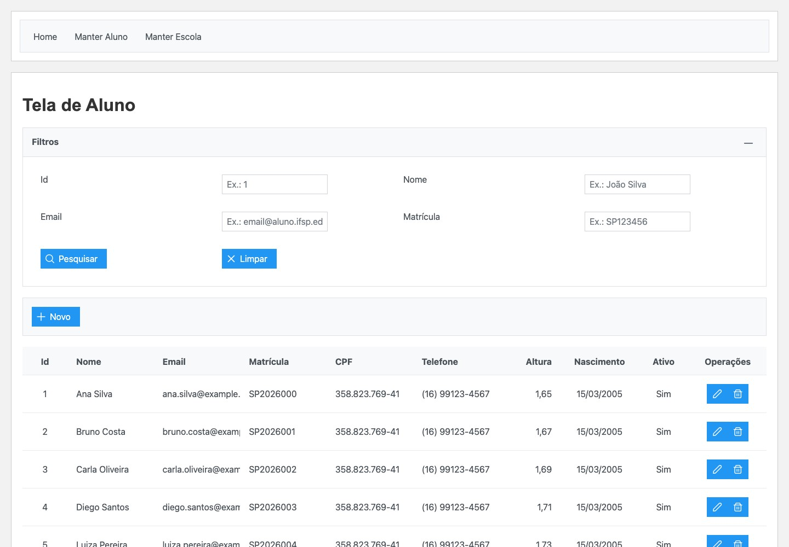
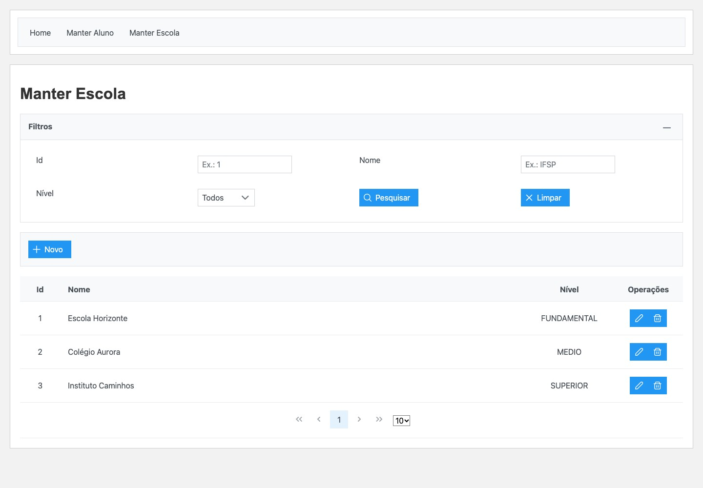
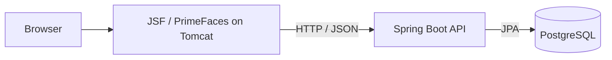

# IF-Aluno — Students and schools

A student and school management application with a Spring Boot REST API and a
JSF/PrimeFaces web interface.

**Status:** Academic project · Programming Language 2, IFSP.

[](https://github.com/ErickHTF/IF-Aluno/actions/workflows/ci.yml)
   

[Run locally](#run-locally) · [Development guide](docs/development.md) ·
[Architecture](docs/architecture.md) · [API reference](docs/api.md)



<details>
<summary>School management</summary>



</details>

_The interface is in Brazilian Portuguese. Screenshots use synthetic data._

## Overview

IF-Aluno demonstrates a server-rendered Java frontend consuming a separate REST
API. Both student and school records support a complete management workflow.

- Create, list, filter, edit and delete students and schools.
- Validate student contact information, enrollment and birth dates.
- Reject duplicate email addresses and enrollment numbers.
- Display field validation and API errors in the interface.

## Stack

| Layer             | Technologies                             |
| ----------------- | ---------------------------------------- |
| Frontend          | JSF, PrimeFaces, Weld, Tomcat 9          |
| Backend           | Java 21, Spring Boot 4, Spring Data JPA  |
| Database          | PostgreSQL 13, Docker Compose            |
| API documentation | springdoc-openapi                        |
| Verification      | Maven, Spring Boot tests, GitHub Actions |

## Run locally

Install **Java 21**, **Git**, and **Docker with Docker Compose**. Maven is
included through the wrappers.

```bash
git clone https://github.com/ErickHTF/IF-Aluno.git
cd IF-Aluno
```

Run these commands in separate terminals, starting from the repository root:

```bash
# Terminal 1 — database
docker compose up -d
```

```bash
# Terminal 2 — API on port 8081
./mvnw spring-boot:run
```

```bash
# Terminal 3 — JSF frontend on port 8080
cd frontend/if-aluno-jsf
./mvnw clean package cargo:run
```

Open [localhost:8080/if-aluno-jsf/](http://localhost:8080/if-aluno-jsf/).
Cargo downloads Tomcat and deploys the frontend WAR. The API creates the database
tables on startup.

See the [development guide](docs/development.md) for Windows commands, dependency
versions, database credentials and service URLs.

## Verification

Keep the local PostgreSQL database running, then execute from the repository root:

```bash
./mvnw verify
cd frontend/if-aluno-jsf
./mvnw package
```

CI verifies the API and builds the frontend with a PostgreSQL service container.

## Architecture



The JSF server consumes the API; the browser interacts with the rendered pages.
The API separates student and school controllers, services and repositories.
Read the [architecture guide](docs/architecture.md) for the source layout and
frontend API configuration.

## Documentation

| Guide                                | Contents                                         |
| ------------------------------------ | ------------------------------------------------ |
| [Development](docs/development.md)   | Setup, ports, dependencies and build commands    |
| [Architecture](docs/architecture.md) | Source layout and communication between services |
| [API reference](docs/api.md)         | Routes, validation rules and request examples    |

## Project context

Developed for the Programming Language 2 course at IFSP. The domain names and
interface are in Portuguese; this README provides an English overview.

No license is currently included in this repository.
